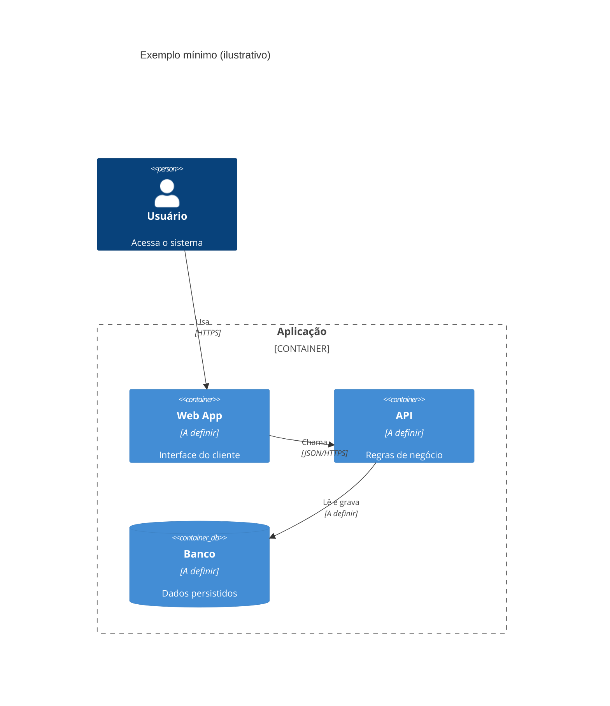

# Diagramas C4 em Mermaid

Use depois de recomendar uma arquitetura, para mostrar o resultado. O diagrama mostra a decisão tomada. O porquê fica no ADR (`adr-writer`).

Baseado em práticas da skill `c4-architecture` (softaworks/agent-toolkit) e adaptado ao projeto.

## Qual nível desenhar

| Nível | Mostra | Quando |
|---|---|---|
| Contexto | O sistema, seus usuários e sistemas externos | Sempre que for desenhar |
| Container | Aplicações, bancos, filas e serviços implantáveis | Sempre que for desenhar |
| Componente | Módulos dentro de um container | Só quando agrega valor |
| Implantação | Infraestrutura e ambientes | Só quando o ambiente de produção estiver definido |
| Dinâmico | Fluxo numerado de uma requisição | Para um processo complexo |

Contexto e Container bastam para a maioria dos casos. Ajuste ao público: executivo vê só o Contexto, produto vê Contexto e Container, dev e DevOps veem o que precisarem.

## Regras

1. Comece pelo Contexto e aprofunde só se precisar. Não crie o Container sem o Contexto.
2. Um nível por diagrama e um diagrama por arquivo. Não misture container com componente.
3. Todo elemento tem nome, tipo, tecnologia (quando aplicável) e descrição. Use `A definir` na tecnologia que ainda não foi decidida, em vez de escolher por conta própria.
4. Setas unidirecionais, rotuladas com verbo de ação e, quando fizer sentido, o protocolo ("Chama", "HTTPS/JSON"). Evite "usa".
5. Menos de 15 elementos por diagrama. Se passar, divida por contexto ou serviço.
6. Sistemas externos são caixa-preta: `System_Ext`, sem detalhes internos.
7. Filas e tópicos aparecem individualmente, não como um broker genérico no centro.
8. Mostre só o que está decidido. O que ainda está em aberto vai marcado como `a validar`, no título ou na descrição.

## Erros comuns

- Classe ou biblioteca compartilhada como container. Container é uma unidade implantável.
- Infraestrutura no diagrama de containers. Use um diagrama de implantação.
- Rótulos genéricos ("usa") e setas bidirecionais ou sem rótulo.
- Termos vagos como "subsistema". Escolha entre sistema, container ou componente.
- Inventar um quinto nível. O C4 tem quatro, e o nível de código fica com UML.
- Mostrar o processo de decisão no diagrama.

## Sintaxe Mermaid

Tipos: `C4Context`, `C4Container`, `C4Component`, `C4Dynamic`, `C4Deployment`.

- Pessoas: `Person`, `Person_Ext`.
- Sistemas: `System`, `System_Ext`, `SystemDb`, `SystemQueue`.
- Containers: `Container`, `ContainerDb`, `ContainerQueue` (parâmetros: alias, nome, tecnologia, descrição).
- Componentes: `Component`, `ComponentDb`, `ComponentQueue`.
- Relação: `Rel(origem, destino, "rótulo", "tecnologia")`.
- Fronteiras: `System_Boundary`, `Container_Boundary`, `Boundary`.
- Layout: `UpdateLayoutConfig($c4ShapeInRow="3", $c4BoundaryInRow="1")`. A ordem em que os elementos são declarados muda a posição.

Limitações do Mermaid: sem tags, legenda nativa, links, linhas tracejadas nem `Lay_*`. O suporte a C4 no Mermaid é experimental e a aparência varia entre versões. Se for importante, confirme a renderização no ambiente do usuário.

## Exemplo mínimo (ilustrativo)



## Saída

Salve em `docs/architecture/` apenas quando o usuário aceitar, um arquivo por diagrama (`c4-context.md`, `c4-containers.md`, `c4-components-<tema>.md`), cada um com o diagrama em bloco ```mermaid e um parágrafo explicando o que ele mostra. Não sobrescreva um arquivo existente sem avisar.
