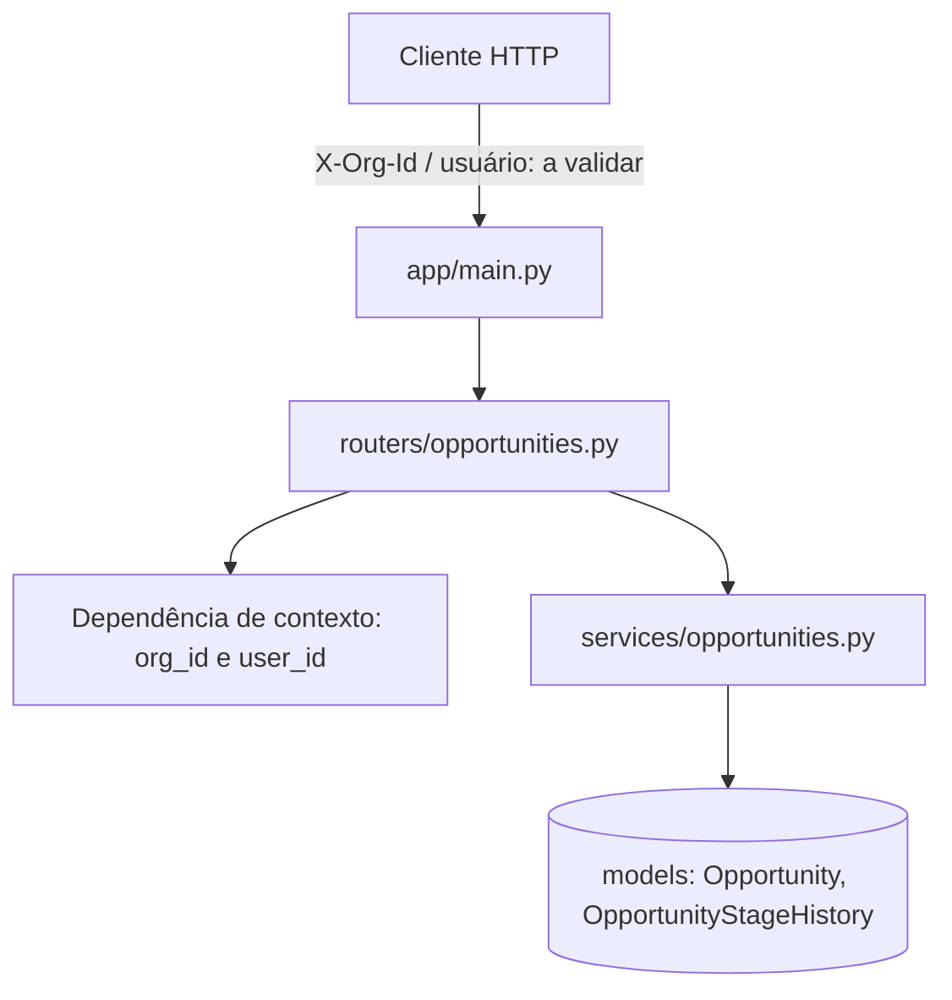

# Design: crm-oportunidades

- **Status:** Rascunho
- **Origem:** evals/architecture-patterns/files/prd-crm-oportunidades.md (RF-01, RF-02, RF-03, RNF-01). O PRD não traz histórias (HU-xx); a rastreabilidade vai até o RF. Destino pretendido: `docs/architecture/crm-oportunidades/design.md`.
- **ADRs:** `docs/adr/` não existe, logo não há ADR `Aceito` a seguir ou substituir.

## Visão geral da arquitetura
Mudança dentro do monolito FastAPI existente (mini-crm), sem serviço novo. O isolamento por organização (RNF-01) é feito por linha (coluna `org_id`, que já existe em `Opportunity`), aplicado em um único ponto de acesso a dados, e não nos handlers. A mudança de etapa grava a oportunidade e um registro de histórico na mesma transação.

## Reuso do que já existe
| Componente existente | Local | Como usar |
|---|---|---|
| `Opportunity` (id, org_id, name, amount) | `app/models.py` | Estender: adicionar `stage` |
| `router` com `GET /opportunities` (retorna `[]`) | `app/routers/opportunities.py` | Estender: implementar a listagem e adicionar POST e PATCH |
| `include_router` e `Base` declarativa | `app/main.py`, `app/models.py` | Reutilizar como estão |
| `test_health` (TestClient) | `tests/test_health.py` | Seguir como padrão de teste |
| fastapi, sqlalchemy, pytest, httpx | `requirements.txt` | Suficientes; nenhuma dependência nova |

Não existe no repositório: autenticação, identificação de usuário/organização, sessão de banco, migrações, validação (schemas Pydantic), logging. Fonte: leitura direta do código (somente 4 arquivos de app e 1 de teste).

| Sistema / ponto de integração | Como integra |
|---|---|
| Provedor de identidade (quem é o usuário e a org) | A definir (ver Perguntas em aberto) |

## Componentes
### Contexto do chamador (`current_context`)
- **Propósito:** entregar `org_id` e `user_id` confiáveis a cada requisição.
- **Local:** `app/deps.py` (novo)
- **Interfaces:** `def current_context() -> Ctx` (dependência FastAPI); `Ctx(org_id: int, user_id: int)`
- **Depende de:** mecanismo de autenticação (a definir)
- **Reaproveita:** sistema de `Depends` do FastAPI
- **Atende:** RF-02 (quem mudou), RF-03, RNF-01

### Modelo de dados
- **Propósito:** persistir oportunidade com etapa e o histórico de mudanças.
- **Local:** `app/models.py`
- **Interfaces:** `Opportunity.stage`; nova `OpportunityStageHistory`
- **Reaproveita:** `Opportunity`, `Base`
- **Atende:** RF-01, RF-02

### Serviço de oportunidades
- **Propósito:** regras de criar, listar e mudar etapa, sempre filtrando por `org_id`.
- **Local:** `app/services/opportunities.py` (novo)
- **Interfaces:**
  - `create(db, ctx, name, amount, stage) -> Opportunity`
  - `list_for_org(db, ctx) -> list[Opportunity]`
  - `change_stage(db, ctx, opp_id, new_stage) -> Opportunity` (levanta `NotFound` se o id não existir na org)
- **Depende de:** modelo de dados, `Ctx`
- **Reaproveita:** `Opportunity`
- **Atende:** RF-01, RF-02, RF-03

### Router de oportunidades
- **Propósito:** expor HTTP e validar entrada.
- **Local:** `app/routers/opportunities.py`
- **Interfaces:**
  - `POST /opportunities` body `{name, amount, stage}` -> 201 com a oportunidade
  - `GET /opportunities` -> 200 lista da org do chamador
  - `PATCH /opportunities/{id}/stage` body `{stage}` -> 200 com a oportunidade
  - Schemas Pydantic (já embutidos no FastAPI) para entrada e saída; `org_id` nunca vem no corpo.
- **Depende de:** serviço, `current_context`
- **Reaproveita:** `router` existente
- **Atende:** RF-01, RF-02, RF-03

## Modelos de dados
- `Opportunity` (existente): `id`, `org_id` (not null), `name` (not null), `amount` (Numeric, nullable hoje), **novo:** `stage` (String, not null).
- `OpportunityStageHistory` (novo): `id`, `opportunity_id` (FK), `org_id`, `from_stage` (nullable na criação), `to_stage`, `changed_by` (user_id), `changed_at` (UTC).
- Índice em `opportunities(org_id)` para a listagem.
- O PRD não define a lista de etapas nem se `amount` é obrigatório: ver Premissas.

## Cobertura de dimensões
| Dimensão | Decisão ou N/A |
|---|---|
| Validação de entrada | Schemas Pydantic no router: `name` não vazio, `amount` >= 0, `stage` dentro do conjunto definido. |
| Falha e falha parcial | `change_stage` atualiza a oportunidade e insere o histórico em uma transação única; ou grava os dois ou nenhum. |
| Idempotência e retry | PATCH para a etapa atual é no-op (200, sem novo histórico). POST sem chave de idempotência: duplicata por retry é aceita (premissa). |
| Autenticação, autorização e rate limit | Autenticação ausente no repo: `current_context` é pré-requisito. Autorização = pertencer à org. Rate limit: N/A, sem requisito. |
| Concorrência e ordem | Duas mudanças simultâneas: vale a última; histórico registra ambas em ordem de `changed_at`/`id`. Lock otimista: N/A, sem requisito. |
| Ciclo de vida dos dados | Retenção do histórico, exclusão e LGPD: não definidos no PRD (pergunta em aberto). |
| Observabilidade | Log de mudança de etapa com `org_id`, `opp_id`, `user_id`; sem métricas (sem requisito). |
| Falha de dependência externa | N/A: sem integração externa além da identidade (a definir). |
| Integridade de transição de estado | Hoje qualquer etapa para qualquer etapa (PRD não restringe). Ponto único em `change_stage` para restringir depois. |

## Isolamento entre organizações (RNF-01, RF-03)
Toda consulta no serviço recebe `ctx.org_id` e filtra por ele; `get` por id também filtra por `org_id`. Oportunidade de outra org responde 404 (não 403), para não revelar existência. O `org_id` vem só do `Ctx`, nunca do corpo ou da query. Teste obrigatório: usuário da org A lista e tenta alterar item da org B.

## Tratamento de erros
| Cenário de erro | Tratamento | Impacto para o usuário |
|---|---|---|
| Entrada inválida | 422 (padrão FastAPI) | Mensagem de campo |
| Oportunidade inexistente ou de outra org | 404 | "Não encontrada" |
| Etapa fora do conjunto | 422 | Mensagem com etapas válidas |
| Sem identidade | 401 | Precisa autenticar |
| Falha ao gravar | Rollback da transação, 500 | Nada é salvo; pode repetir |

## Riscos e preocupações
| Preocupação | Local | Impacto | Mitigação |
|---|---|---|---|
| `org_id` sem FK nem índice; nenhuma identidade no repo | `app/models.py:9`, `app/main.py` | Segurança: vazamento entre orgs se o contexto for forjável | `current_context` como passo 1; teste de isolamento |
| `GET /opportunities` hoje retorna `[]` fixo, sem filtro | `app/routers/opportunities.py:7` | Ao implementar, esquecer o filtro vaza dados | Filtro só no serviço, sem consulta direta no router |
| Sem sessão de banco, engine ou migrações | repositório inteiro | Dívida técnica: não há como persistir hoje | Passo 2 cria sessão; migração (ex.: Alembic) a decidir, não verificado |
| Apenas teste de `/health` | `tests/test_health.py` | Lacuna de teste | Testes por endpoint e de isolamento nos passos |
| `amount` é `Numeric` sem precisão definida | `app/models.py:13` | Arredondamento | Definir precisão e moeda (pergunta) |

## Decisões técnicas
| Decisão | Escolha | Motivo | ADR |
|---|---|---|---|
| Estilo | Monolito existente, camadas simples (router, serviço, modelo) | Time e escopo pequenos; nenhum requisito pede serviço separado | Não |
| Isolamento multi-tenant | Coluna `org_id` por linha, filtro no serviço | Já existe a coluna; esquema ou banco por org custa operação sem requisito que o exija | Sim, recomendado (vale para o projeto todo) |
| Histórico | Tabela append-only de mudanças | RF-02 pede quem mudou; event sourcing seria excesso | Não |
| `org_id` e `user_id` | Vêm de dependência de contexto, nunca do corpo | Evita forjar a org | Junto do ADR de isolamento |

Alternativas descartadas: schema por org e banco por org (custo operacional sem requisito); filtro automático global no ORM (mais mágico, mais difícil de testar; reavaliar se o número de entidades crescer).

## Plano de implementação
1. **Contexto do chamador**
   - **Onde:** `app/deps.py`
   - **Depende de:** decisão de autenticação (pergunta 1); até lá, stub de teste
   - **Reaproveita:** `Depends`
   - **Atende:** RF-02, RF-03, RNF-01
   - **Pronto quando:** requisição sem identidade recebe 401; com identidade, o handler recebe `Ctx`.
2. **Sessão de banco e modelos**
   - **Onde:** `app/db.py` (novo), `app/models.py`
   - **Depende de:** nenhum
   - **Reaproveita:** `Base`, `Opportunity`
   - **Atende:** RF-01, RF-02
   - **Pronto quando:** tabelas criam; `Opportunity.stage` e `OpportunityStageHistory` existem; índice em `org_id`.
3. **Serviço**
   - **Onde:** `app/services/opportunities.py`
   - **Depende de:** 1 e 2
   - **Atende:** RF-01, RF-02, RF-03
   - **Pronto quando:** `list_for_org` nunca devolve item de outra org; `change_stage` grava histórico com `changed_by` na mesma transação; teste unitário cobre as duas coisas.
4. **Endpoints**
   - **Onde:** `app/routers/opportunities.py`
   - **Depende de:** 3
   - **Reaproveita:** `router`, padrão de `tests/test_health.py`
   - **Atende:** RF-01, RF-02, RF-03
   - **Pronto quando:** POST cria e o item aparece no GET da mesma org; PATCH altera etapa e gera histórico; org B recebe 404 no PATCH de item da org A e não vê itens no GET.

## Decisões fixadas e critério do implementador
- **Fixadas:** isolamento por `org_id` em toda consulta (RNF-01); histórico registra quem mudou (RF-02). Nenhum ADR aceito existe.
- **Critério do implementador:** nomes de arquivos de serviço, formato dos schemas, escolha de ferramenta de migração, banco de desenvolvimento.

## Premissas
| Tema | Padrão adotado | Motivo | Confirmada? |
|---|---|---|---|
| Etapas do funil | Lista fechada, valores a definir pelo produto | PRD cita "etapa" sem listar | Não |
| Transições | Livres entre quaisquer etapas | PRD não restringe | Não |
| `amount` | Obrigatório e >= 0 | PRD lista "valor" como campo do cadastro | Não |
| Moeda | Única, sem campo de moeda | PRD omite | Não |
| Usuário pertence a uma única org | Sim | RF-03 fala em "própria organização" | Não |
| Retry de POST | Pode duplicar | Sem requisito de idempotência | Não |
| Edição e exclusão de oportunidade | Fora do escopo | Não estão nos RFs | Não |

## Perguntas em aberto
1. Como o usuário se autentica e de onde vem a org (token, sessão, cabeçalho de gateway)? Responsável: produto e arquitetura. Bloqueia o passo 1.
2. Quais são as etapas do funil e há restrição de transição? Produto.
3. Há requisito de retenção/exclusão do histórico e de LGPD? Produto.
4. Qual banco e como serão feitas as migrações? Não verificado no repositório. Time.
5. Há expectativa de volume por organização (afeta paginação da listagem)? Hoje sem número; a listagem não pagina (premissa).
