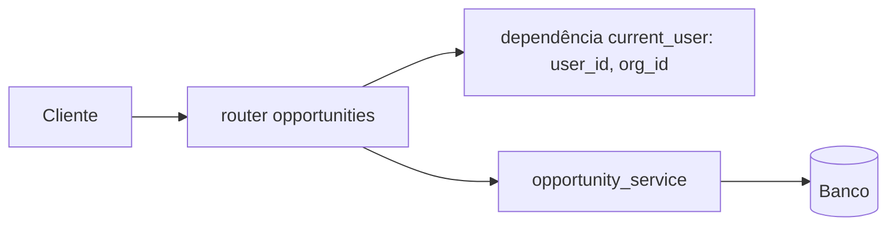

# Design técnico: oportunidades do CRM

## 1. Contexto
Rastreabilidade: RF-01, RF-02, RF-03, RNF-01 (PRD `prd-crm-oportunidades.md`).

Estado atual do `mini-crm` (FastAPI 0.115, SQLAlchemy 2.0, pytest, httpx):
- `app/models.py`: `Opportunity` com `id`, `org_id`, `name`, `amount`. Não tem etapa nem histórico.
- `app/routers/opportunities.py`: só `GET /opportunities` devolvendo `[]`.
- Não há sessão de banco, autenticação, nem noção de usuário ou organização na requisição. Banco e SGBD não estão definidos.

## 2. Decisão de arquitetura
Manter o **monolito atual em camadas simples** (router, serviço, modelo). Um único processo FastAPI e um único banco. Não há requisito que justifique microsserviços, filas ou CQRS.

Isolamento (RNF-01): **multi-tenant com banco compartilhado e coluna `org_id`**, pois `org_id` já existe no modelo. Duas barreiras:
1. `org_id` vem sempre do contexto autenticado, nunca do corpo ou da URL.
2. Todo acesso passa por um serviço que sempre filtra por `org_id` (não há query sem filtro nos routers).

Alternativas descartadas: banco ou schema por organização (custo operacional sem requisito de volume ou contrato que exija); filtro "por convenção" em cada router (fácil de esquecer).

## 3. Componentes

- `app/deps.py` (novo): `get_db` (sessão) e `get_current_user` (devolve `user_id`, `org_id`). **Como o usuário é autenticado não está no PRD: pergunta em aberto (seção 7).**
- `app/services/opportunities.py` (novo): `create`, `change_stage`, `list`, todos recebendo `org_id`.
- `app/routers/opportunities.py`: valida entrada/saída (Pydantic) e chama o serviço.
- `app/models.py`: ajustes abaixo.

## 4. Modelo de dados
`opportunities`: acrescentar `stage` (String, not null), `created_at`. Índice em `org_id`. Ajustar `name` e `amount`: o RF-01 pede valor, então `amount` passa a `nullable=False` (premissa: valor é obrigatório).

`opportunity_stage_history` (novo), para RF-02:
| Campo | Tipo | Nota |
|---|---|---|
| id | Integer PK | |
| opportunity_id | FK | |
| org_id | Integer, not null | redundante de propósito, para filtrar sem join |
| from_stage | String, null na criação | |
| to_stage | String | |
| changed_by | Integer (id do usuário) | quem mudou |
| changed_at | DateTime | |

Etapas: o PRD não lista as etapas do funil. Premissa: `stage` é texto validado contra uma lista configurada em código (`STAGES`), valores `A definir`. Não criar tabela de etapas por organização sem requisito.

A mudança de etapa e o registro no histórico acontecem **na mesma transação**.

Migrações: não há ferramenta no repo. Para a primeira versão, `Base.metadata.create_all`; adotar Alembic quando houver dados reais (`A definir`).

## 5. API (contrato mínimo)
| Requisito | Endpoint | Corpo | Resposta |
|---|---|---|---|
| RF-01 | `POST /opportunities` | `{name, amount, stage}` | 201 + oportunidade |
| RF-03 | `GET /opportunities` | | 200 + lista só da org do usuário |
| RF-02 | `PATCH /opportunities/{id}/stage` | `{stage}` | 200 + oportunidade |
| RF-02 | `GET /opportunities/{id}/history` | | 200 + histórico (para o critério "histórico registra quem mudou") |

Erros: 401 sem autenticação; 422 etapa inválida ou campo ausente; **404** (não 403) quando o id existe mas é de outra organização, para não vazar existência. Paginação na listagem: `A definir` (sem volume informado); começar com `limit/offset`.

## 6. Rastreabilidade
| Requisito | Componente | Teste de aceite |
|---|---|---|
| RF-01 | `POST /opportunities`, service.create | Criar e ver na lista da org |
| RF-02 | `PATCH .../stage`, tabela de histórico | Mudar etapa, conferir `changed_by` no histórico |
| RF-03 | service.list com filtro `org_id` | Org A cria, usuário da org B lista e não vê |
| RNF-01 | `get_current_user` + filtro obrigatório no service | Org B tenta `PATCH`/`GET` por id da org A e recebe 404 |

Testes: ampliar `tests/` com `TestClient` e SQLite em memória, com foco nos casos de isolamento entre organizações.

## 7. Perguntas em aberto e premissas
1. Autenticação: JWT, sessão ou gateway externo? De onde vêm `user_id` e `org_id`? (bloqueia a implementação; até lá, dependência substituível em testes.)
2. Quais são as etapas do funil e a ordem delas? Pode voltar etapa ou pular?
3. SGBD de produção (premissa: PostgreSQL; em teste, SQLite).
4. `amount` obrigatório? Moeda? (premissa: obrigatório, moeda única `A definir`).
5. Volume esperado, que define paginação e índices.
6. Permissões por papel (vendedor só vê as suas?): o PRD diz apenas "da própria organização".
7. Reforço extra do isolamento (Row Level Security no PostgreSQL): adiar até confirmar o SGBD; registrar em ADR se adotado.

## 8. ADRs sugeridos
- 0001: multi-tenancy por coluna `org_id` em banco compartilhado.
- 0002: histórico de etapas em tabela própria, gravado na mesma transação.
